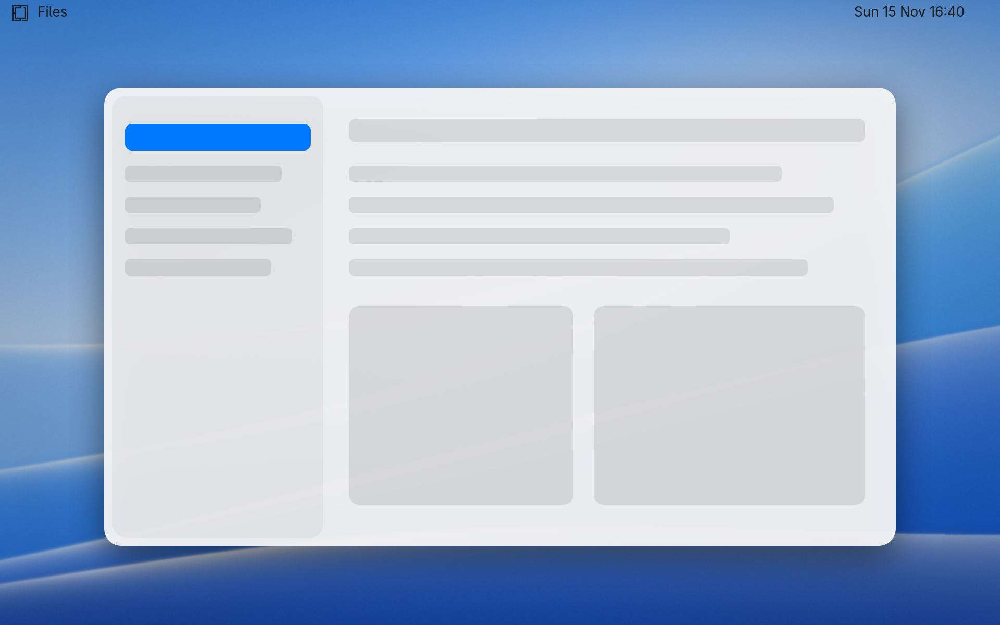

# macOS Tahoe Light for Omarchy

The light variant of [macOS Tahoe for Omarchy](https://github.com/hoangkim28/omarchy-macos-tahoe-theme): Apple's light system colors, hairline borders, and frosted white Liquid Glass–style menus, panels and notifications.



## Install

```sh
omarchy theme install https://github.com/hoangkim28/omarchy-macos-tahoe-light-theme
```

Recommended packages:

```sh
omarchy pkg add inter-font
omarchy pkg aur add whitesur-icon-theme apple_cursor
```

The theme sets the `WhiteSur` icon theme.

## Wallpaper

An original wallpaper, "Tahoe Day", is included: layered glassy waves generated for this theme. Apple's macOS Tahoe wallpapers are not, because they are Apple's copyrighted work. Download the official *macOS Tahoe 26* light wallpaper yourself and put it in `~/.config/omarchy/backgrounds/macos-tahoe-light/`.

## The macOS window look

Corners, shadows, glass blur, hidden window buttons, the macOS menu bar, cursor and font come from the optional extras in the [dark theme's repository](https://github.com/hoangkim28/omarchy-macos-tahoe-theme#optional-extras-the-macos-window-look). They apply to both variants.

## Not affiliated with Apple

macOS is a trademark of Apple Inc. This is an unofficial fan theme.

## License

MIT, see [LICENSE](LICENSE).
